# ТЗ 48 — UGC: полный заказ, кабинет клиента и рабочее место креатора

> **Текущая цель основателя, 2026-10-29 (D572):** реализовать пункты [сравнения UGC](../UGC_MARKET_BENCHMARK.md) и сделать взаимодействие клиента и креатора сопоставимым с сильными UGC-площадками. Эта сессия фиксирует требования и архитектуру интерфейса; реализация ещё не начата.
> Действующая база — [ТЗ 27](27-ugc.md), единый аккаунт — [ТЗ 30](30-one-account.md), визуальные правила — [DESIGN.md](../DESIGN.md), понятные ошибки — [ERROR_DIAGNOSTICS.md](../ERROR_DIAGNOSTICS.md). До выпуска соответствующей подфазы продолжает работать прежний процесс.

## 1. Результат для пользователя

Клиент создаёт бриф, выбирает подходящего креатора, фиксирует объём работы и права, обеспечивает бюджет, ведёт заказ, получает материал, запрашивает предусмотренную правку и принимает результат. Креатор понимает до согласия, что снимать, сколько он заработает, когда сдавать и когда ждать выплату. После согласия обе стороны видят одну карточку заказа с одинаковыми условиями, материалами и историей решений.

Заказ поддерживает два явно обозначенных результата: **«Видео для бренда»** (файл без обязательной публикации у автора) и **«Видео и публикация»** (файл и пост на согласованном аккаунте/площадке). Права использования и тип результата — разные поля. `ads` не означает автоматического запуска рекламы, `whitelist` не означает, что аккаунт уже подключён.

Начальный консервативный выбор D572: основным сделать путь «Видео для бренда»; путь с публикацией выпускать отдельной подфазой. В первой версии заказа остаются один ролик и одна включённая правка. Модель версий допускает развитие, но произвольное число работ, платные допродажи и подписки креатора не добавляются автоматически.

Цель выполнена, когда обе стороны проходят полный опубликованный сценарий, включая отказ/правку/ошибку и подтверждённый расчёт. Наличие локальной страницы или отметки «долг записан» не закрывает цель.

## 2. Что изучено у аналогов

Источники проверены 2026-10-29. Изучены официальные руководства, названия действий и опубликованные иллюстрации Insense и JoinBrands. Закрытые кабинеты с реальными заказами не проходились; историческая иллюстрация в статье может отличаться от текущего релиза. Внутренние таблицы и сервисы конкурентов неизвестны. Следующая архитектура данных — проектное решение для INTGETION.

| Источник                                                                                                                                                                                                                | Наблюдаемый экран и действия                                                                                                                                                                 | Что используем                                                                                                                                                  |
| ----------------------------------------------------------------------------------------------------------------------------------------------------------------------------------------------------------------------- | -------------------------------------------------------------------------------------------------------------------------------------------------------------------------------------------- | --------------------------------------------------------------------------------------------------------------------------------------------------------------- |
| [Insense: обзор кампаний](https://help.insense.pro/4333)                                                                                                                                                                | Список кампаний, фильтр бренда и состояния, счётчики заявок, сообщений и контента на проверку; счётчик открывает нужную очередь.                                                             | Обзор строится вокруг работы, ожидающей человека. Каждое число имеет переход и понятный объект.                                                                 |
| [Insense: кампания](https://help.insense.pro/4330)                                                                                                                                                                      | Отклики/приглашения и нанятые разделены; есть фильтры, просмотр брифа, приглашение, пауза и копирование.                                                                                     | Отдельно показывать набор команды и производство. Пауза набора не останавливает уже оплаченный заказ.                                                           |
| [Insense: чат](https://help.insense.pro/4329)                                                                                                                                                                           | Фильтры, список креаторов, условия и переписка; кнопка найма рядом с ценой, информация о доставке после найма, непрочитанные сообщения. На иллюстрации контекст сделки соседствует с лентой. | Комната заказа объединяет контекст и обсуждение, а найм/правки/приёмка остаются явными командами.                                                               |
| [Insense: сторона креатора](https://help-creators.insense.pro/4524)                                                                                                                                                     | В опубликованной нижней навигации пять пунктов: Explore, Invitations, My Work, Chats, Account. Фильтры помогают выбрать работу; приглашения вынесены отдельно.                               | Собственный кабинет креатора с текущей работой и приглашениями. Общий аккаунт INTGETION сохраняется.                                                            |
| [Billo: выбор автора](https://help.billo.app/en/articles/4775361-reviewing-creator-applications)                                                                                                                        | Бриф → очередь одобрения → профиль и примеры → выбор состава заказа → подтверждение. Видны видео и показатели выполнения.                                                                    | Клиент видит доказательства пригодности и итоговую сумму до предложения найма.                                                                                  |
| [Billo: проверка видео](https://help.billo.app/en/articles/4825150-for-brands-how-to-request-edits-and-reshoots)                                                                                                        | В очереди проверки открывается боковая карточка контента; запрос правки содержит конкретную причину. Сообщение в чате не меняет статус проверки.                                             | Выделенный режим просмотра, версия ролика, сверка с брифом и структурированный запрос правки.                                                                   |
| [JoinBrands: навигация](https://help.joinbrands.com/en/articles/6360412-how-to-navigate-the-dashboard), [кампания](https://help.joinbrands.com/en/articles/15825269-managing-your-campaigns-the-my-campaigns-tab)       | Разделы кампаний и библиотеки материалов, список следующих действий. На иллюстрации боковая сводка связывает набор, производство и проверку с кнопками Approve, Invite More и Review.        | Постоянная сводка кампании, переход от счётчика к нужным строкам, прогресс по результатам.                                                                      |
| [JoinBrands: работа автора](https://help.joinbrands.com/en/articles/14760019-creators-how-to-find-and-apply-for-jobs), [сроки](https://help.joinbrands.com/en/articles/8732671-brands-a-guide-to-job-status-and-timers) | Выбор задания, получение продукта, съёмка, сдача, решение и выплата имеют отдельные шаги.                                                                                                    | Срок съёмки физического товара учитывает получение товара; у проверки есть ответственный и срок. Их автоматическую приёмку без отдельного решения не переносим. |

Чужие цвета, графику и весь набор разделов не копировать. Для нашего кабинета действует D519: токены обеих тем, существующий `strong` для главного действия рабочего экрана, синий фокус, тонкие разделители, Geist/Geist Mono. Компоненты — существующий UI-kit. Для получения результата Spoki остаётся доступен, но форма и кнопки позволяют завершить заказ без разговора с моделью.

## 3. Навигация и контекст аккаунта

Один пользователь может одновременно быть креатором и членом компаний. Переключение «Я заказываю / Я создаю» меняет рабочий контекст и навигацию, не создаёт аккаунт и не меняет права. Контекст компании берётся из общей модели D570; у пользователя с несколькими компаниями название выбранной компании видно в заголовке. «Все компании» допустимо только для обзора с явными названиями компаний в строках. Любая запись требует одной выбранной компании и серверной проверки членства.

| Сторона     | Раздел и маршрут                                              | Назначение                                                                                          |
| ----------- | ------------------------------------------------------------- | --------------------------------------------------------------------------------------------------- |
| Клиент      | `/campaigns`                                                  | Обзор: ожидают моего решения, сроки, бюджет, последние сдачи.                                       |
| Клиент      | `/campaigns/list`, `/campaigns/creators`, `/campaigns/orders` | Кампании, выбор авторов, активная работа. Существующие адреса сохраняются.                          |
| Клиент      | `/campaigns/materials`, `/campaigns/payments`                 | Материалы с версиями/правами; взносы, начисления, выплаты, возвраты.                                |
| Креатор     | `/creator/workspace` — новый                                  | Моя работа на сегодня, приглашения, ближайшие сроки и деньги.                                       |
| Креатор     | `/creator/campaigns`, `/creator/invites`                      | Поиск работы и предложения; существующие страницы расширяются.                                      |
| Креатор     | `/creator/orders`, `/creator/payments` — новые                | Заказы по этапам и история дохода.                                                                  |
| Креатор     | `/creator`                                                    | Существующий профиль, примеры работ, доступность и приглашения. Старые ссылки сохраняют назначение. |
| Обе стороны | `/campaigns/[id]/orders/[inviteId]` — новый                   | Одна комната конкретного участия с разрешёнными для роли данными и действиями.                      |

В комнате нет ссылки, открывающей чужой кабинет компании. `campaignId` и `inviteId` должны соответствовать друг другу. Переход из уведомления открывает нужный заказ и его раздел, а не общий чат. На мобильном — компактная навигация кабинета и одна открытая комната; вторую постоянную нижнюю панель поверх общей навигации не добавлять.

```mermaid
flowchart LR
  Account[Единый аккаунт] --> Brand[Заказываю: выбранная компания]
  Account --> Creator[Создаю: мой профиль]
  Brand --> Brief[Бриф и подбор]
  Creator --> Feed[Лента и приглашения]
  Brief --> Offer[Предложение с условиями]
  Feed --> Offer
  Offer --> Consent[Согласие креатора и обеспеченный бюджет]
  Consent --> Room[Общая комната заказа]
  Room --> Delivery[Товар при необходимости]
  Delivery --> Versions[Съёмка и версии материала]
  Versions --> Review[Проверка и предусмотренная правка]
  Review --> Accepted[Принятие]
  Accepted --> Post[Публикация если заказана]
  Post --> Settlement[Подтверждённая выплата]
```



## 4. Экран клиента: обзор и кампания

На обзоре сверху — контекст компании и одно главное действие «Создать бриф». «С помощью Spoki» — вторичное. Далее список «Ждёт вашего решения»: проверить видео, ответить автору, подтвердить отправку товара, внести бюджет. Сортировка по просрочке и ближайшему сроку, а не по произвольной дате создания. У строки — кампания, креатор, причина ожидания и одна кнопка перехода. Ноль задач означает «Сейчас действий не требуется»; ошибка загрузки не превращается в ноль.

Таблица кампаний: продукт, статус набора, авторы, результаты в работе/на проверке/приняты, ближайший срок, бюджет. Фильтры компании, статуса и поиска хранятся в URL. Нажатие «3 видео на проверке» открывает отфильтрованную очередь материалов данной кампании. На телефоне те же данные — карточками с приоритетом следующего шага.

Страница кампании содержит заголовок, ссылку «Бриф», прогресс и вкладки «Отклики», «В работе», «Материалы», «Бюджет». Вторичные «Приостановить набор», «Копировать бриф», «Закрыть набор» — в меню с текстовыми подписями. Закрытие набора не закрывает сдачу, переписку, выплаты и споры существующих заказов. Полное завершение кампании возможно только после урегулирования обязательств.

## 5. Создание брифа и подтверждение условий

Сохранить общий `ugc_brief_drafts` для формы и Spoki. Мастер формы: **Результат → Продукт и аудитория → Требования → Креаторы и сроки → Бюджет и права → Проверка**. Названия шагов и весь UI — на семи языках. Справа на desktop — сводка количества результатов, цены за результат, бюджета, прав и этапов; на телефоне сводка раскрывается перед финальным подтверждением.

| Шаг              | Поля и действия                                                                     | Правило                                                                                                                        |
| ---------------- | ----------------------------------------------------------------------------------- | ------------------------------------------------------------------------------------------------------------------------------ |
| Результат        | «Видео для бренда» / «Видео и публикация», формат, длительность, соотношение сторон | Не требовать аккаунт с аудиторией для content-only заказа. Не показывать пока недоступный вариант как рабочий.                 |
| Продукт          | Название, описание, ссылка, аудитория, цифровой/физический                          | Для физического продукта выбрать способ доставки; адреса не писать в публичный бриф.                                           |
| Требования       | Тезисы, запреты, примеры, критерии приёмки, вопросы при отклике                     | Требование становится частью версии брифа. Текст в переписке сам по себе не расширяет объём заказа.                            |
| Креаторы и сроки | Ниша, языки, страны, число авторов, срок ответа на предложение и сдачи              | Показать, от какой даты считается срок: согласие или получение товара.                                                         |
| Бюджет и права   | Цена за результат, общий бюджет, включённая правка, лицензия                        | Автор до согласия видит ту же цену, объём и права. Действующий платёжный путь D466 сохраняется до отдельной замены.            |
| Проверка         | Полный бриф, допущения Spoki, «Исправить», «Отправить на проверку»                  | Последняя кнопка — явная команда. Черновик можно сохранить и продолжить; отправка повторным кликом не создаёт вторую кампанию. |

«Назад» сохраняет заполненные поля в текущей форме. «Сохранить черновик» имеет состояния «Сохраняем / Сохранено / Не сохранено: повторить». После истечения сессии предложить вход и безопасное восстановление черновика в исходном аккаунте, не переносить чужие данные при смене пользователя.

## 6. Подбор и найм: что видят обе стороны

Карточка автора для клиента: имя/фото при наличии разрешённого хранения, языки, страна, ниши, примеры видео и подтверждённые показатели платформы. Новому автору показывается «Пока нет завершённых заказов», без выдуманного рейтинга. Просмотр примеров и условий доступен до предложения. Контакты, адрес доставки и кошелёк в каталоге отсутствуют.

| Кто / экран            | Кнопка                              | Предусловие и результат                                                                                                                          |
| ---------------------- | ----------------------------------- | ------------------------------------------------------------------------------------------------------------------------------------------------ |
| Клиент / карточка      | «Посмотреть работы»                 | Открывает профиль/панель с примерами, сохраняет фильтры и позицию списка.                                                                        |
| Клиент / отклики       | «В подборку» / «Убрать из подборки» | Только метка текущей кампании; не найм и не уведомление автору.                                                                                  |
| Клиент / отклик        | «Задать вопрос»                     | Открывает нить конкретного участия; правила контактов сохраняются.                                                                               |
| Клиент / карточка      | «Предложить заказ»                  | Открывает итоговые условия; отправка доступна при разрешённом наборе и обеспеченном бюджете. Нет бюджета — видимое объяснение и «Внести бюджет». |
| Клиент / подтверждение | «Отправить предложение»             | Сервер фиксирует версию условий и сумму, уведомляет автора; на клиенте видно «Ждём ответа до …».                                                 |
| Клиент / отклик        | «Отклонить отклик»                  | Не затрагивает активный заказ. Требует краткую причину из безопасного списка, автор видит результат.                                             |
| Креатор / бриф         | «Откликнуться»                      | Предварительный просмотр результата, срока, награды и прав; вопросы брифа заполняются до отправки.                                               |
| Креатор / приглашение  | «Посмотреть условия»                | Открывает полный бриф и снимок предложения, срок ответа и статус бюджета.                                                                        |
| Креатор / предложение  | «Принять заказ» / «Отказаться»      | Только адресат и актуальное предложение. Согласие выполняется сервером один раз; expired нельзя принять из старой вкладки.                       |
| Креатор / свой отклик  | «Отозвать отклик»                   | Только до найма; после найма используется отдельное урегулирование заказа.                                                                       |

Любое предложение другой цены или срока — отдельный объект изменения условий с явным подтверждением обеих сторон. Свободный торг и оплата дополнительных роликов не входят в первую подфазу; на ней цена фиксирована, как в ТЗ 27. Подборка, новые вопросы и причины отклонения потребуют данных, поэтому не имитировать их локальными временными отметками как сохранённые функции.

## 7. Рабочее место креатора

Главный блок «Сейчас нужно»: принять предложение, дождаться товара, загрузить видео, внести правку, отправить ссылку публикации. Карточка заказа показывает бренд, продукт, сумму, этап, ближайший срок с часовым поясом и основное действие. Разделы «Предложения», «В работе», «На проверке», «Завершено» не скрывают ожидание выплаты за принятую работу.

На ленте работы карточка сразу показывает тип результата, награду, срок, язык/площадку, необходимость товара и краткую причину соответствия. «Открыть бриф» — просмотр; «Откликнуться» — отдельная запись. Сохранять поиск, сортировку, выбранные фильтры и страницу в URL. Если профиль неполный — объяснить отсутствующие поля и вести на `/creator`, не выдавать это за отсутствие подходящих брифов.

Деньги разделены на «За принятую работу», «Ожидает перевода», «Выплачено» и проблемы выплаты. «Выплачено» появляется по серверному подтверждению. Эти суммы не означают доступный к выводу баланс, пока такой механизм не реализован. Кнопки «Вывести» до появления реального рельса нет; есть «Настроить способ получения» и «Посмотреть выплату».

## 8. Общая комната заказа

Desktop: заголовок с брендом/креатором, этапом и ближайшим сроком; основная область — текущий материал или история, справа — условия и следующее действие. Лента содержит сообщения и события с автором, временем и объектом. В кампании с несколькими авторами у каждого участия собственная комната. На узком экране — один столбец и переключение «Заказ / Материалы / Обсуждение» с непрочитанным счётчиком; открытие сообщения не сбрасывает выбранную версию ролика.

```text
Кампания / Автор                 На проверке · решение до …
───────────────────────────────────────────────────────────
Материал / Обсуждение            Условия заказа
Видео выбранной версии          1 ролик · награда · права
Версия 2 · отправлена …          Срок · 1 включённая правка
                                [Открыть бриф]
История и комментарии           [Принять результат]
                                Запросить правку
                                Сообщить о проблеме
```

Это схема нашей компоновки. Главное действие зависит от роли и этапа; клиент видит проверку, автор — состояние проверки и ответственный следующий шаг. Одновременно один визуально главный CTA, остальные вторичны. На телефоне нижнее действие не перекрывает клавиатуру, субтитры или фокус.

| Этап                | Клиент                                                         | Креатор                                                 | Следующее состояние                                                                        |
| ------------------- | -------------------------------------------------------------- | ------------------------------------------------------- | ------------------------------------------------------------------------------------------ |
| Предложение         | «Изучить предложение», при необходимости отозвать до согласия  | «Принять заказ», «Отказаться», «Задать вопрос»          | Согласован заказ или закрыто предложение.                                                  |
| Товар нужен         | «Указать отправку», трек и ожидаемая дата                      | «Подтвердить получение», «Есть проблема с доставкой»    | После подтверждения начинается согласованный срок производства.                            |
| Производство        | Смотреть ход, отвечать на вопросы                              | «Загрузить видео», затем «Отправить на проверку»        | Загрузка сама не сдаёт работу; сдача происходит отдельной командой.                        |
| Проверка            | «Принять результат», «Запросить правку», «Сообщить о проблеме» | Смотреть замечания и срок решения, отправить сообщение  | Принятие, правка или рассмотрение проблемы.                                                |
| Правка              | Видеть предыдущую версию и запрос                              | «Загрузить исправление», «Отправить новую версию»       | Новая неизменяемая версия снова на проверке.                                               |
| Публикация заказана | Видеть одобренный материал, согласованный пост и срок          | «Добавить ссылку публикации»                            | Проверка обязательства публикации; доступ к файлу и статус выплаты показываются раздельно. |
| Выплата             | Внесено / начислено / выплачено / возврат                      | Ожидает перевода / подтверждено / требуется исправление | Только подтверждённая сервером операция закрывает платёжный шаг.                           |
| Завершено           | «Скачать результат», «Заказать ещё»                            | «Посмотреть результат», «Открыть выплату»               | Новый заказ создаётся новым согласованным предложением, старые условия не меняются.        |

Переписка — между людьми. Spoki может объяснить этап, подготовить текст и предложить команду по просьбе пользователя; не отправляет сообщения другой стороне, не принимает условия и не одобряет материал сам. История заказа не хранится в краткоживущей истории Spoki. Решения о сроке хранения сообщений и материалов фиксируются до запуска хранения.

## 9. Материалы, правки и права использования

У материала есть оригинал, подготовленное превью, метаданные и неизменяемые версии. Предыдущая версия после правки остаётся доступной сторонам в пределах политики хранения. Файл не скачивается сервером с произвольной ссылки. Прежние социальные ссылки остаются `legacy_link`; их нельзя объявить скачиваемым оригиналом или подтверждённым постом.

Состояния загрузки: выбран → загружается с прогрессом → обрабатывается → готов → отправлен. Ошибка сети допускает возобновление/повтор без создания дубликата; неверный формат и превышенный размер сообщаются до сдачи. Проверка на сервере обязательна. До готовности файла «Отправить на проверку» недоступна с объяснением. Точные лимиты файла, срок хранения, регион и стоимость обработки — OPEN QUESTION перед подфазой файлов.

Просмотр клиента: плеер с управлением, версия, требования из согласованного брифа и область замечаний. Запрос правки включает причину и привязку к требованию; таймкод можно добавить, но он не обязателен. Перед отправкой видно, сколько включённых правок осталось. Превышение объёма требует отдельного согласия, не списывает деньги и не уменьшает награду односторонне.

Перед «Принять результат» — компактное подтверждение: версия, результат, сумма обязательства и последствия. «Победитель» остаётся творческой меткой, а не условием оплаты: обычная приёмка тоже создаёт обязательство. Для режима с публикацией договор заранее определяет, когда начисляется награда; до этого такой режим не запускается с денежными обещаниями.

Материал хранится приватно; проверка доступа выполняется до выдачи короткой подписанной ссылки. Скачивание оригинала зависит от согласованной лицензии и этапа. Ревьюер компании не получает адрес доставки или кошелёк без необходимости. Снимок лицензии содержит версию условий, стороны, назначение, площадки, период и территорию, а не только enum `organic/ads/whitelist`. Юридический текст и момент перехода прав остаются на согласовании по D465/D466.

## 10. Сроки, ожидание и проблемные случаи

Каждый этап показывает: **кто должен действовать, до какой даты, что произойдёт при задержке**. Дата отображается с часовым поясом; обратный отсчёт дополняет её, не заменяет. Не использовать один срок кампании для набора, доставки, производства и проверки.

До отдельного согласования политики приёмки молчание клиента запускает напоминание и эскалацию в поддержку, не автоматическое принятие/перевод. Изменение срока содержит причину и историю; если затрагивает обязательство другой стороны — её явное согласие. Просрочка не удаляет материалы и не делает клиента автоматически победителем спора.

| Ситуация                          | Поведение интерфейса                                                                            |
| --------------------------------- | ----------------------------------------------------------------------------------------------- |
| Ничего не создано                 | Объяснение следующего шага и «Создать бриф» / «Заполнить профиль».                              |
| По фильтру пусто                  | «Нет результатов» и «Сбросить фильтры», без сброса сохранённого черновика.                      |
| Данные ещё загружаются            | Skeleton и `aria-busy`; предыдущая известная информация не подменяется нулями.                  |
| Сбой API/сети                     | Понятная причина, «Повторить», ID обращения; введённый текст сохраняется.                       |
| Сессия истекла                    | «Войти снова» с возвратом в тот же заказ и проверкой текущего пользователя.                     |
| Состояние изменил другой участник | Обновить данные, объяснить конфликт; устаревшая кнопка не выполняет повторное решение.          |
| Бюджет не подтверждён             | Видимый статус ожидания; нельзя нанять/обещать обеспеченную оплату раньше проверки.             |
| Автор или клиент не отвечает      | «Сообщить о проблеме» с контекстом заказа, статус обращения и ответственный следующий шаг.      |
| Недостаточно прав                 | Не показывать чужие материалы; понятное ограничение для своей компании, 404 для чужого объекта. |

Уведомление ведёт прямо к действию. Повторные уведомления одного события подавляются; настройки каналов соблюдаются. Анонс «пришло видео» не содержит приватной ссылки на скачивание файла без авторизации.

## 11. Архитектура и существующий код

Сохранить Next.js, Supabase/PostgreSQL, Drizzle, единый аккаунт и публичную границу `src/modules/ugc/service/index.ts`. Не выносить UGC в отдельную авторизацию и не создавать дубликат заказа в модуле фриланса. `ugc_invites` остаётся идентификатором участия и основой комнаты; отдельная таблица `ugc_orders` не нужна, если те же инварианты выражаются участием и дочерними объектами.

| Объект           | Сейчас                                                  | Целевое расширение                                                                                                                                                        |
| ---------------- | ------------------------------------------------------- | ------------------------------------------------------------------------------------------------------------------------------------------------------------------------- |
| Профиль креатора | `creator_profiles`, ссылки-примеры, приглашения         | Портфолио из разрешённых завершённых работ, сведения о доступности; показатели только из подтверждённых событий.                                                          |
| Бриф             | `ugc_brief_drafts`, `ugc_campaigns`                     | Тип результата, технические требования, логистика и версионированный бриф. Правки общего текста после найма не меняют согласованный снимок.                               |
| Участие          | `ugc_invites`, снимок цены и прав                       | Полный снимок условий, отдельные сроки, ответы на вопросы, связь с версией брифа и явное согласие.                                                                        |
| Материал         | Одна `ugc_submissions` на участие                       | Сохранить логический результат; добавить дочерние версии, объекты хранения и структурированные решения. Не перезаписывать старую URL-версию.                              |
| Комната          | Нити Spoki                                              | Долговечная предметная лента сообщений/событий UGC. Паттерны ТЗ 45 изучить, но не обращаться к repo фриланса напрямую и не переносить его сроки хранения без решения.     |
| Доставка         | Нет                                                     | Приватный объект участия: способ, доступ к адресату, отправлено/получено/проблема, трек и даты.                                                                           |
| Деньги           | `ugc_deposits`, `ugc_payouts`, проверка транзакций      | История начисления/перевода/возврата, сверка и видимость для обеих сторон; существующий ручной путь честно обозначен. Автоматический перевод — отдельный рельс и решение. |
| Чтения кабинета  | `companyWorkspace` читает весь набор, вложенные запросы | Выборки по компании/роли/этапу, серверная пагинация, агрегаты отдельно от детальных строк. Профили и выплаты читать пакетами.                                             |

Кампания, участие, производство, доставка, проверка и выплата — независимые оси состояния. Не кодировать их одной огромной строкой статуса. «Видео принято, выплата ожидается» — допустимое состояние. «Набор закрыт, заказ в работе» — тоже. UI получает разрешённые действия и следующий шаг из сервиса, сервер повторно проверяет право и версию при записи.

Изменение решения и создание денежного обязательства выполняются в одной транзакции с защитой от повторов. Уведомления/обработка файлов запускаются после зафиксированной записи с повторяемой доставкой; успешная запись не теряется из-за отказа почты. Перед выбором очереди проверить существующую инфраструктуру; отдельная зависимость не обязательна. Для новых чтений API сначала расширить действующие команды/сервис, не писать параллельный бизнес-путь для нового UI.

Вычисляемая модель кабинета: роль, компания, заказ, текущие состояния, ближайший срок, ответственный, разрешённые действия, безопасная причина недоступности. Способ хранения не попадает в текст кнопок. Все внешние ссылки, ответы автора и сообщения остаются недоверенными данными для Spoki.

## 12. Внешний вид и доступность

- Переиспользовать `DeskShell`, `DeskNav`, `StepTrack`, `VideoReviewItem`, `UgcAction`, формы и `src/components/ui/`. Вся новая копия — `src/messages/*.json` для семи языков.
- На рабочем экране одна главная кнопка. «Пригласить», «Принять», «Отправить на проверку» имеют разные смыслы; не использовать общее «Продолжить» для обязательства.
- Статус имеет текст и значок, не только цвет. Суммы и даты — моноширинные; цена за единицу и общая сумма различимы.
- Действия доступны клавиатурой; диалог удерживает фокус, Esc закрывает, фокус возвращается к вызвавшей кнопке. Ошибка связана с полем. Цели касания 44 px, контраст проверяется в обеих темах.
- Для загрузки и записи виден прогресс; кнопка повторной записи заблокирована только на время операции. Недоступность по бизнес-правилу объясняется рядом, не одним серым состоянием.
- Плеер не включается со звуком автоматически, не требует мыши; подготовленные субтитры доступны при наличии. Внешняя legacy-ссылка обозначена как открытие другой площадки.
- Фильтры, выбранная вкладка и история браузера работают по прямым адресам. На mobile не требуется горизонтальная прокрутка всей страницы; проверка материалов и отправка сообщений работают при открытой клавиатуре.

## 13. Подфазы и критерии завершения

| Подфаза                        | Состав                                                                                                                     | Готово, когда                                                                                                                                          |
| ------------------------------ | -------------------------------------------------------------------------------------------------------------------------- | ------------------------------------------------------------------------------------------------------------------------------------------------------ |
| U0 — эта сессия                | Цель, источники, экраны, кнопки, состояния, модель данных и порядок                                                        | ТЗ 48, D572, INDEX/CURRENT/OPEN_TASKS согласованы; статус реализации честно указан.                                                                    |
| U1 — рабочее место креатора    | Обзор, мои заказы, следующий шаг, сроки и деньги из существующих данных                                                    | Автор без Spoki видит свои действия, открывает заказ/существующий сценарий, не видит чужое; локально можно начать при заблокированном production Auth. |
| U2 — чтения и контекст клиента | Пагинация, пакетные чтения, фильтры, общий company context D570                                                            | Размер ответа ограничен; число запросов не растёт по одному на каждого автора; смена компании не переносит права или формы.                            |
| U3 — условия и выбор автора    | Версии брифа, снимок условий, вопросы, подборка, подтверждение найма                                                       | Оба участника согласились на одинаковый объём, сумму, срок и права; изменение требует нового согласия.                                                 |
| U4 — комната и сроки           | Лента UGC, сообщения, события, следующие действия, напоминания и обращения                                                 | Оба участника работают в одном заказе; сообщение не подменяет приёмку; хранение/модерация определены до запуска.                                       |
| U5 — передача видео            | Сдача ссылки (D573, файлы не храним): проверка площадки, версии ссылок, снимок на приёмку, жалоба «не открывается»         | Первая и исправленная версии доступны; неверная ссылка отклонена; чужое не видно. Зависит от лицензии и текста условий.                                |
| U6 — товар и публикация        | Физическая доставка, подтверждение получения; отдельный путь поста                                                         | Срок учитывает товар; публикация не начинается до одобрения; контент-only не требует поста. Условия выплаты для режима определены.                     |
| U7 — расчёт и защита сделки    | Проверка текущего пути выплат/возврата, статусы проблем, урегулирование; затем отдельно согласованный автоматический рельс | Реальные подтверждения совпадают с UI; отказ не теряет денежное обязательство; поддержка видит историю. Платные/юридические решения закрыты.           |
| U8 — выпуск и приёмка          | Два тестовых аккаунта, desktop/mobile, уведомления, восстановление после ошибок                                            | Полный путь работает на опубликованном сайте; нет незакрытого блокирующего сценария.                                                                   |

Одна подфаза за сессию по протоколу. Миграции нужны с U3 и далее по выбранной модели, номер выделяется перед реализацией; эта спецификация не резервирует `0074` и не меняет существующие `0071`–`0073`. Код U1 и U2 можно готовить локально до снятия ограничения Auth; проверка живых ролей и выпуск требуют работающего входа.

Минимальная приёмочная матрица каждой затронутой подфазы: клиент одной компании, клиент двух компаний, креатор, человек в обеих ролях, посторонний, гость. Проверить двойной клик/повтор запроса, конфликт версий, истёкшее предложение, паузу набора при активном заказе, одну правку, неизвестную ошибку, отсутствие файла и неподтверждённый перевод. Изменения данных проверяются интеграционно в CI; UI — на desktop и телефоне. Общие проверки по `00-protocol.md` и AGENTS.md.

## 14. Решения, необходимые перед зависимыми подфазами

Цель полного UGC-заказа принята. Открыты конкретные параметры, а не вопрос, нужен ли этот модуль:

1. ~~Хранение~~ — решено D573 (2026-10-29): вариант C, только ссылка, файлы не храним. Было: поставщик/регион, размер и формат файлов, срок хранения оригиналов/версий, стоимость, правила удаления. Сначала сравнить возможности уже используемого Storage и объём egress; не выбирать провайдера только по названию.
2. ~~Договор~~ — решено D574 (2026-10-29). Было: условия лицензии и перехода прав, период/территория, момент начисления при заказе с публикацией, порядок спора. Сохранить фактические решения D465/D466 и получить недостающие условия.
3. ~~Сроки~~ — решено D574 (2026-10-29). Было: период проверки, напоминания и эскалация; до решения нет автоматической приёмки молчанием.
4. ~~Переписка~~ — решено D574 (2026-10-29). Было: срок хранения и удаления, доступ поддержки, правила модерации и жалобы; контакты публично не раскрываются.
5. Деньги: стоимость плана UGC, рельс автоматизации, комиссии и сроки перевода. Нынешний ручной путь можно улучшить отдельно, не выдавая его за автоматический.

Параметры перед зависимой реализацией записываются в DECISIONS. Проектирование экранов и U1 не ждут этих ответов. Платные подписки, новые зависимости, изменения секретов, облака и выкладка идут по разрешениям текущей задачи; чужие данные и работающие настройки не используются для экспериментов.

## 15. U1 — сделано локально (2026-10-29, ветка `claude/ugc-workspace`)

- **Ядро:** `src/modules/ugc/service/creator-workspace.ts` — чистая сборка рабочего места креатора из его участий: этапы `offer`, `applied`, `submit`, `changes`, `overdue`, `review`, `payout_wait`, `paid`, `rejected`, `closed`; разделы «Предложения и отклики», «В работе», «На проверке», «Завершено»; список «Сейчас нужно» по ближайшему сроку; деньги раздельно — «За принятую работу», «Ожидает перевода», «Выплачено». Просроченное не показывается как доступное действие; ожидающий отклик не попадает в «Сейчас нужно».
- **Чтение:** `getCreatorWorkspace(userId)` в `commands.ts`, публичный экспорт через `service/index.ts`. Только участия самого пользователя, не более 100; пагинация — U2. Миграций нет.
- **Страница:** `/creator/workspace` (вход обязателен), ссылка «Моя работа» с `/creator` для автора с профилем. Кнопки ведут в нить участия `/chat?invite=…` — приём предложения и сдача видео остаются существующими карточками; нового пути записи нет. Кнопки «Вывести» нет: суммы — обязательства и подтверждённые переводы, не баланс (§7).
- **Тексты:** `ugc.workspace` на 7 языках.
- **Тесты:** `src/modules/ugc/__tests__/creator-workspace.test.ts` — 10. `pnpm typecheck`, `pnpm lint`, `pnpm test` (239 файлов, 1792 теста), `pnpm build` — 0.
- **Не проверено:** вид страницы под входом и на телефоне (вход на localhost заблокирован квотой Supabase), скринридер, живые данные.
- **Отклонение от §3:** отдельные страницы `/creator/orders` и `/creator/payments` не созданы — их содержимое вошло в одну страницу рабочего места; разделение решается после проверки вида.

## 16. U2 — сделано локально (2026-10-29, ветка `claude/ugc-workspace`)

- **Чтения кабинета клиента стали пакетными.** `companyWorkspace` читает одинаковое число раз при любом числе кампаний, авторов и видео (кампании, приглашения, видео, бюджеты — четыре чтения; люди, выплаты, состояние взноса — ещё три только для нужных строк). Раньше на каждую кампанию и каждого автора шло отдельное чтение. Новые методы `UgcStore`: `listInvitesForCampaigns`, `getProfiles`, `listPayoutsBySubmissions`, `confirmedDepositsMinor`; `latestDeposits` в `escrow-repo`, `depositStatesFor` в `escrow.ts`.
- **Выбор компании.** `companyWorkspace(userId, { companyId })` отдаёт только её кампании; чужой или неизвестный id даёт пусто, не чужие данные (тест).
- **Список кампаний `/campaigns/list`:** страница по 10 (`companyDeskPage`), фильтр статуса, поиск по названию, выбор компании кнопками при двух и более компаниях, название выбранной компании в заголовке; всё хранится в URL (`view`, `company`, `q`, `page`), по умолчанию адрес короткий. Страница за пределами конца возвращает последнюю.
- **Проверка равенства:** тест сверяет новые данные с тем, что отдают прежние `readCampaign` и `listMyCampaignSummaries` (бриф, участники, сводка совпадают). Тест на число чтений: 1 кампания и 7 кампаний с 19 авторами дают одинаковое число обращений к хранилищу.
- **Тесты:** `src/modules/ugc/__tests__/company-desk.test.ts` (8). `pnpm typecheck`, `pnpm lint`, `pnpm test` (240 файлов, 1800 тестов), `pnpm build` — 0. Миграций нет; тексты `ugcDesk` на 7 языках.
- **Не проверено:** SQL новых пакетных чтений (`distinct on`, `in (...)`) против настоящей базы — нужен CI с базой (локально Docker нет); вид списка под входом и на телефоне (квота Supabase).
- **Доделано (2026-10-29):** выбор компании и страницы по 10 есть на всех страницах кабинета: «Заказы», «Материалы», «Креаторы» (люди в кампаниях), «Оплаты» (начисления) и «Обзор» (только выбор компании); общие части — `DeskCompanies`, `DeskPager`, `paginate`, `deskPath` (`desk-query.ts`), `loadDesk(userId, companyId)`. Выбор живёт в адресе (`?company=`, `?view=`, `?page=`), чужой id ничего не выбирает и ничего не показывает. Блок «Ждёт вашего решения» на обзоре уже был (`attentionItems`) и теперь учитывает выбранную компанию. Тесты адресов и страниц: `desk-query.test.ts` (6).
- **Остаётся неразбитым по страницам:** таблица бюджетов по кампаниям на «Оплатах» и блок подбора на «Креаторах» (читаются целиком, пакетно; ограничены числом кампаний одной компании); общий выбор компании в шапке кабинета отдельным элементом не делался — на каждой странице те же кнопки. Живая база и вид под входом не проверены.

## 17. U3а — сделано локально (2026-10-29, ветка `claude/ugc-workspace`)

Часть U3: снимок условий и согласие автора. Вопросы при отклике, подборка и история версий брифа остаются на U3б.

- **Снимок:** `service/terms.ts` — условия предложения (одно видео, награда, срок, права, лицензия 6 мес. и весь мир, проверка 5 рабочих дней по D574, площадки, «нужно/нельзя сказать», питч, примеры) и их хэш. Снимок кладётся на приглашение при `offerHire`.
- **Согласие:** `acceptInvite` принимает хэш условий, которые автор видел на странице. Чужой хэш — 409 `UGC_TERMS_MISMATCH`. Если текст брифа изменился после предложения — 409 `UGC_TERMS_CHANGED`: автор не может принять, а компания отправляет предложение заново (`offerHire` по устаревшему предложению обновляет снимок и сбрасывает согласие). Принятие пишет `agreed_hash`, `agreed_at`. Предложения без снимка (до миграции) принимаются как раньше.
- **Страница автора:** блок «Условия предложения», сообщение «Бриф изменился», кнопка «Принять» скрыта при изменении, дата согласия. Тексты на 7 языках (`ugc.terms*`, `ugc.agreedAt`).
- **Миграция `0074_ugc_terms_snapshot.sql`:** четыре nullable колонки в `ugc_invites`. Локально не применялась; в облако только по отдельному «да».
- **Тесты:** `terms.test.ts` (5), `terms-flow.test.ts` (6): снимок, согласие, чужой хэш, изменение брифа и повторная отправка, старое предложение.
- **Не сделано (U3б):** вопросы при отклике, подборка клиента, история версий брифа, показ согласованных условий компании на карточке участника, интеграционный тест на настоящей базе.

## 18. U3б (часть 1) — подборка клиента, локально (2026-10-29)

- Метка «В подборку» на отклике (`setShortlist`, действие API `shortlist`): ставят только участники компании, только пока отклик в статусе `applied`; автор метку не видит и уведомления не получает; в списке отклики из подборки идут первыми; аудит `ugc.shortlist_add` / `ugc.shortlist_remove`.
- Миграция `0075_ugc_shortlist.sql` (колонка `shortlisted boolean not null default false`): не применялась. Без неё код выкладывать нельзя.
- Тесты `shortlist.test.ts` (4). Тексты `ugc.shortlistAdd`, `shortlistRemove`, `shortlisted` на 7 языках.
- Остаётся в U3б: вопросы брифа при отклике, причина отклонения отклика из безопасного списка, история версий брифа.

## 19. U3б (часть 2) — вопросы брифа и отклонение отклика, локально (2026-10-29)

- **Вопросы:** бриф задаёт до 3 вопросов (до 200 знаков, без контактов); клиент правит их в форме текста открытого брифа (`editText`, поле `questions`). Автор отвечает при отклике (`apply` принимает `answers`, по одному ответу на вопрос, до 500 знаков, без контактов); без ответов отклик не создаётся (400). Клиент видит ответы в строке отклика. Вопросы не входят в снимок условий: их правка не делает предложение устаревшим. Вопросы нельзя задать при создании брифа (мастер и черновики не менялись) — только после открытия.
- **Отклонение:** `rejectApplication` — только отклик в статусе `applied`, причина из списка «Не подходит / Набор закрыт / Другая причина» (код `declineReason`, не свободный текст); отклик становится `declined`, метка подборки снимается, автору уходит уведомление `ugc.application`, автор видит причину на странице брифа.
- **Миграция `0076_ugc_questions.sql`:** `ugc_campaigns.questions`, `ugc_invites.answers`, `ugc_invites.decline_reason` с проверками. Не применялась; вместе с `0074` и `0075` — перед выкладкой.
- **Тесты:** `questions-reject.test.ts` (7). Тексты на 7 языках.
- **Остаётся:** история версий брифа; вопросы в мастере создания брифа; показ согласованных условий на карточке участника у компании; интеграционный тест трёх миграций на настоящей базе (CI).

## 20. U3б (часть 3) — история версий брифа, U3 закрыта локально (2026-10-29)

- **Что пишется:** при каждой сохранённой правке текстов открытого брифа (описание, питч, «нужно/нельзя сказать», примеры, вопросы) сервис сохраняет версию: номер, кто изменил, какие поля, полный снимок текстов. Первая правка сохраняет и состояние до неё как версию 1, поэтому история начинается с того, что авторы увидели первым. Правка без изменений версию не создаёт. Версии только добавляются: приложение их не меняет и не удаляет (права `SELECT, INSERT`).
- **Что видно:** клиент (участники компании) видит на странице брифа список «История версий брифа» — номер, дата, названия изменённых полей. Автор историю не видит: он видит условия своего предложения (снимок U3а). Согласованные условия не меняются задним числом ни версией, ни правкой текста.
- **Миграция `0077_ugc_campaign_versions.sql`:** таблица `ugc_campaign_versions` (deny-all RLS). Не применялась; вместе с `0074`–`0076` перед выкладкой.
- **Тесты:** `versions.test.ts` (8). Тексты на 7 языках.
- **Статус U3:** снимок условий и согласие, подборка, вопросы с ответами, отклонение с причиной и история версий сделаны локально. Сделано локально в доделке U3: на карточке участника у компании — предложенные условия и предупреждение, если бриф изменился после предложения; в истории версий — «до → после» по каждому изменённому полю. Остаётся вне U3: вопросы в мастере создания брифа (черновик идёт через путь бота: нужна схема черновика, и `createCampaign` пока не сохраняет вопросы), интеграционный тест миграций на настоящей базе (CI).

## 21. U4а — комната заказа: сообщения, локально (2026-10-29)

- **Что есть:** у каждого участия со статусом «предложено» или «нанят» своя комната `/campaigns/[id]/room/[inviteId]`: лента сообщений и событий («Предложение отправлено», «Автор согласился с условиями») по времени, форма сообщения. Видят и пишут только автор участия и участники компании кампании; остальным 404. Автор может задать вопрос до согласия. Сообщения не принимают условия и не одобряют материал.
- **Правила по D574:** контакты и ссылки в тексте запрещены (422 `CONTACTS_IN_TEXT`), до 2000 знаков, 30 сообщений в час на аккаунт (`ugcMessage`), после отказа, отзыва, истечения или завершения набора писать нельзя (409 `UGC_ROOM_CLOSED`). Скрытое модератором сообщение остаётся строкой без текста; удалённый автор показывается как «Удалённый аккаунт».
- **До миграции:** без таблицы `ugc_room_messages` лента приходит пустой с пометкой, отправка отвечает 503 `UGC_ROOM_NOT_READY`; страница работает.
- **Миграция `0078_ugc_room_messages.sql`:** не применялась; вместе с `0074`–`0077` перед выкладкой.
- **Тесты:** `room.test.ts` (10). Тексты на 7 языках.
- **Не сделано (U4б):** уведомление другой стороне о новом сообщении и счётчик непрочитанного (нужен новый тип уведомления и каталог); кнопка «Пожаловаться» и очередь модерации сообщений; чистка текста через 12 месяцев после закрытия (D574); напоминание проверки на 3-й день и за день до конца, эскалация в поддержку; события «видео отправлено/решение» в ленте (у сдач нет меток времени); переключатель «Заказ / Материалы / Обсуждение» на телефоне.

## 22. U4б (часть 1) — срок проверки, напоминания, уведомления о сообщениях, локально (2026-10-29)

- **Часы проверки (D574):** решение компании по видео — 5 рабочих дней (пн–пт, UTC, праздники не учитываются) с момента отправки. Напоминание на 3-й рабочий день, второе — за рабочий день до конца, в конце срока — эскалация: запись аудита `ugc.review_escalated`, пометка `escalated_at` у сдачи и последнее уведомление компании. Пропущенный этап не досылается: уходит только высший наступивший. Молчание видео не принимает и выплату не создаёт. Исправленное видео запускает часы заново.
- **Видно обеим сторонам:** «Компания решает до {дата}» у видео на проверке (у клиента в карточке материала, у автора на странице брифа).
- **Запуск:** существующий `/api/cron/ugc` (`noteDeadlines`) возвращает `reviews: { reminded, escalated }`. Расписание не менялось.
- **Уведомления:** новые типы `ugc.review_due` (письмо по умолчанию включено) и `ugc.message` (только на сайте) — каталог, схемы, тексты на 7 языках. Сообщение комнаты уведомляет другую сторону, не автора.
- **Миграция `0079_ugc_review_clock.sql`:** `submitted_at`, `review_stage`, `escalated_at` у `ugc_submissions`; видео, ждущие решения, получают старт часов по последнему изменению. Не применялась; вместе с `0074`–`0078` перед выкладкой.
- **Тесты:** `review-clock.test.ts` (4), `review-reminders.test.ts` (8). Всего тестов 1857.
- **Не сделано (U4б, дальше):** экран очереди эскалаций для поддержки (сейчас только аудит и пометка); счётчик непрочитанного; кнопка «Пожаловаться» и модерация сообщений; чистка текста через 12 месяцев; события сдачи и решения в ленте комнаты; переключатель «Заказ / Материалы / Обсуждение» на телефоне; напоминание автору об истёкшем сроке проверки.

## 23. U4б (часть 2) — жалобы, чистка, очередь эскалаций; U4 закрыта локально (2026-10-29)

- **Жалобы на сообщения:** под сообщением другой стороны кнопка «Пожаловаться» с причиной из списка «Спам / Оскорбления или угрозы / Контакты или ссылки / Другое». Жалуется только участник этой комнаты, не на своё сообщение, одна жалоба от человека на сообщение (409 `ALREADY_REPORTED`). Текст остаётся, пока модератор не решил. Своя таблица `ugc_room_reports`; общая очередь модерации (`reports`) не менялась, чтобы не расширять чужие ограничения базы.
- **Решение модератора:** на `/admin/campaigns` блок «Жалобы на сообщения»: «Скрыть сообщение» (строка остаётся без текста, `hidden_by`, аудит `ugc.room_message_hidden`) или «Отклонить жалобу» (аудит `ugc.room_report_dismissed`). Только админ; повторное решение — 409.
- **Эскалации:** тот же экран показывает «Видео с истёкшим сроком проверки»: бриф, дата окончания срока, ссылка в комнату. Запись исчезает, когда компания решила по видео.
- **Чистка (D574):** `sweepRoomMessages` в `/api/cron/ugc` удаляет текст комнат, закрытых больше 12 месяцев назад (отказ, истечение, отзыв предложения — по `updated_at` участия; закрытый бриф — по `updated_at` брифа). До миграции `0078` возвращает ноль.
- **Миграция `0080_ugc_room_reports.sql`:** не применялась; вместе с `0074`–`0079` перед выкладкой.
- **Тесты:** `room-moderation.test.ts` (7). Тексты на 7 языках. Всего тестов 1864.
- **Статус U4:** сообщения, уведомления, часы проверки, напоминания, эскалация и очередь, жалобы, скрытие, чистка сделаны локально. Событие «видео отправлено» в ленте добавлено локально (последняя отправка; тест в `room.test.ts`). Сделано локально (миграция `0085`, в облако не применена, D438): событие «компания ответила» в ленте (`decided_at`) и счётчик непрочитанного на вкладке «Обсуждение» (`ugc_room_reads`). Остаётся вне U4: доступ поддержки к переписке по спору (читает только по жалобе или спору, с аудитом) — сейчас модератор видит только жалобный текст; проверка всех миграций на настоящей базе (CI). Переключатель «Заказ / Материалы / Обсуждение» сделан локально: на узком экране три вкладки, на широком все разделы в один столбец; «Материалы» — ссылка на видео и её версии (решение основателя). Напоминание автору об истёкшем сроке проверки сделано локально: при эскалации автору уходит уведомление `ugc.review_late` (письмо и приложение, 7 языков, тест в `review-reminders.test.ts`).

## 24. U5 — передача видео ссылкой, локально (2026-10-29)

- **Модель (D573):** файлы не храним. Каждая ссылка, которую автор отправил по одному видео, сохраняется как версия (`ugc_submission_versions`): первая и исправленная не перезаписывают друг друга. Ссылка, которую компания приняла, помечается `accepted_at` и после этого не меняется: повторная отправка принятого видео отклоняется (409). Видео, отправленное до миграции, получает версию 1 из своей прежней ссылки при первой замене.
- **Проверка ссылки:** сервер по-прежнему принимает только https-ссылки на TikTok, Instagram, YouTube; страницы не загружаются и не проверяются на доступность.
- **«Ссылка не открывается»:** клиент по видео на проверке нажимает кнопку один раз (`brokenLink`): автору уходит уведомление `ugc.submission_decided` с решением `link_broken` (текст на 7 языках), аудит `ugc.link_reported`. Автор отправляет новую ссылку на ту же сдачу без траты включённой правки; часы проверки (5 рабочих дней) стартуют заново, компания по-прежнему может запросить свою одну правку. Без жалобы вторая ссылка отклоняется.
- **Экраны:** у клиента в карточке материала список версий ссылки с отметкой «принята» и кнопка «Ссылка не открывается»; у автора на странице брифа список версий и сообщение «Компания сообщила, что ссылка не открывается».
- **До миграции `0081`:** чтения и запись версий защищены от отсутствия таблицы (пустой список, сдача и приёмка работают), но колонка `link_reported_at` нужна для сохранения сдачи: выкладывать код только после применения `0081`.
- **Миграция `0081_ugc_submission_versions.sql`:** не применялась; вместе с `0074`–`0080` перед выкладкой.
- **Тесты:** `link-versions.test.ts` (9). Всего тестов 1873.
- **Не сделано:** предпросмотр ролика на странице (встраивание площадок требует решения по CSP и политике сторонних плееров); проверка доступности ссылки сервером; сравнение версий; скачивание по правам не нужно при модели «только ссылка» (D573).

## 25. U6 — доставка физического товара, локально (2026-10-29)

**Выключено решением D575 (2026-10-29):** принимаются только цифровые продукты; переключатель `UGC_PHYSICAL_LIVE = false`, блок скрыт, отправка отвечает 409 `UGC_PHYSICAL_OFF`. Ниже описано то, что включится позже.

- **Что есть:** в комнате заказа блок «Доставка товара». Компания по нанятому автору отмечает отправку (служба доставки, номер, ожидаемая дата — необязательно, до 60 дней вперёд, без контактов в тексте). Автор подтверждает получение или сообщает о проблеме («Не пришёл», «Повреждён», «Не тот товар»); после проблемы компания может отправить заново, а автор — подтвердить получение, если товар пришёл позже. Обе стороны видят одно состояние: в пути, получено, проблема. События «товар отмечен как отправленный», «автор подтвердил получение», «автор сообщил о проблеме» стоят в ленте комнаты. Аудит `ugc.shipment_sent`, `ugc.shipment_received`, `ugc.shipment_problem`.
- **Условия:** доставка начинается только после согласия автора (статус «нанят»); отметки пишут только свои стороны (компания — отправку, автор — получение и проблему), остальным 404. Один заказ — одна отправка.
- **До миграции `0082`:** комната открывается без блока доставки; запись отправки требует таблицы.
- **Публикация:** путь поста уже отделён: ссылка на пост принимается только после принятия видео, контент без публикации поста не требует (U5 не менялась).
- **Миграция `0082_ugc_shipments.sql`:** не применялась; вместе с `0074`–`0081` перед выкладкой.
- **Тесты:** `delivery.test.ts` (16). Тексты на 7 языках. Сравнение готовых решений — `docs/REFERENCE_SOLUTIONS.md`. Всего тестов 1884.
- **Не сделано и ждёт решения основателя:**
  - адрес доставки: безопасная передача автором компании после найма с удалением по сроку (это персональные данные, нужно решение о хранении и удалении); пока адрес нигде не хранится и в комнате контакты запрещены;
  - срок съёмки от получения товара: сейчас срок один — срок брифа;
  - тип заказа «цифровой / физический» в мастере брифа: сейчас доставку включает сама отметка отправки;
  - уведомления автору и клиенту о доставке (новый тип в каталоге);
  - автоматическое отслеживание посылки (платный сервис или зависимость);
  - условия выплаты для режима с публикацией (D574 даёт момент начисления при принятии видео).

## 26. U7 (часть 1) — проблемы по заказу и урегулирование, локально (2026-10-29)

- **Что проверено в действующем пути денег (D465, D466):** взнос брифа, начисление при принятии видео, выплата и возврат с проверкой квитанции сервером уже работают и покрыты тестами `escrow.test.ts`, `escrow.integration.test.ts` (в CI). U7 их не менял. Автоматический перевод не добавлялся: он ждёт п. 5 §14 (цена плана UGC, юрист по деньгам, рельс).
- **Проблема по заказу:** в комнате заказа у нанятого автора есть блок «Проблема с заказом». Любая сторона нажимает «Сообщить о проблеме», выбирает причину («Другая сторона не отвечает», «Качество работы», «Оплата», «Ссылка», «Другое») и коротко пишет (до 500 знаков, без контактов). Одновременно одна нерешённая проблема на заказ (409 `UGC_DISPUTE_OPEN`). Обе стороны видят одно и то же: статус («Ждёт поддержки», «Поддержка рассматривает», «Закрыто»), кто сообщил, причину и итог. События стоят в ленте.
- **Поддержка:** на `/admin/campaigns` блок «Проблемы в заказах»: причина, текст, ссылка в комнату, «Взять в работу» и закрытие с итогом: «в пользу компании», «в пользу автора», «стороны договорились», «отклонено». Итог — запись: он не принимает и не отклоняет видео и не создаёт и не отменяет выплату; дальше поддержка действует обычными командами (приём, выплата вручную по D466).
- **Уведомления:** новый тип `ugc.dispute` (письмо по умолчанию включено): другой стороне при открытии, обеим сторонам при закрытии. Аудит `ugc.dispute_opened`, `ugc.dispute_in_review`, `ugc.dispute_resolved`.
- **Миграция `0083_ugc_disputes.sql`:** таблица `ugc_disputes`, частичный уникальный индекс «одна нерешённая на заказ». Не применялась; вместе с `0074`–`0082` перед выкладкой. До неё комната открывается без блока, подача отвечает 503 `UGC_DISPUTE_NOT_READY`.
- **Тесты:** `disputes.test.ts` (9). Тексты на 7 языках. Всего тестов 1894.
- **Не сделано:** история денег для обеих сторон (взнос, начисление, перевод, возврат) в одном списке — у выплат нет метки времени начисления; блокировка выплаты при открытой проблеме (сейчас только видимость, выплата ручная); срок реакции поддержки и напоминания ей; автоматический рельс (ждёт п. 5 §14).

## 27. U7 (часть 2) — история денег и удержание выплаты, U7 закрыта локально (2026-10-29)

- **История денег по заказу:** в комнате блок «Деньги по заказу» из существующих записей без новых таблиц. Компания видит «Бюджет внесён» (подтверждённый взнос брифа), «Награда начислена», «Награда выплачена» и «Остаток возвращён»; автор видит только «Награда начислена» и «Награда выплачена». События идут по времени, суммы моноширинные, показаны только подтверждённые операции; выплаты по-прежнему делаются вручную по D466 и появляются после проверки перевода сервером. Посторонний — 404, гость — 401.
- **Метка начисления:** запись выплаты теперь отдаёт `createdAt` (колонка `created_at` в `ugc_payouts` уже была, миграции не нужно).
- **Удержание выплаты:** пока по заказу открыта проблема (U7, часть 1), награду нельзя отметить выплаченной — ни вручную, ни с проверкой перевода (409 `UGC_DISPUTE_OPEN_PAYOUT`). В списке выплат у админа такая запись показывает «По этому заказу открыта проблема. Закройте её перед выплатой» без форм. После закрытия проблемы выплата доступна. Возвраты брифа не удерживаются. До миграции `0083` удержания нет (проблем ещё не бывает).
- **Тесты:** `money-flow.test.ts` (8). Тексты на 7 языках. Всего тестов 1902. Новых миграций нет.
- **Статус U7:** путь D465/D466 проверен и не менялся; проблемы, урегулирование поддержкой, история денег и удержание выплаты сделаны локально. **Не сделано:** автоматический рельс выплат и цена плана «UGC» (п. 5 §14: ждут ваших ответов и юриста), срок реакции поддержки и напоминания ей, сверка внутри платформы «внесено = начислено + возврат + остаток» одним экраном для поддержки.
